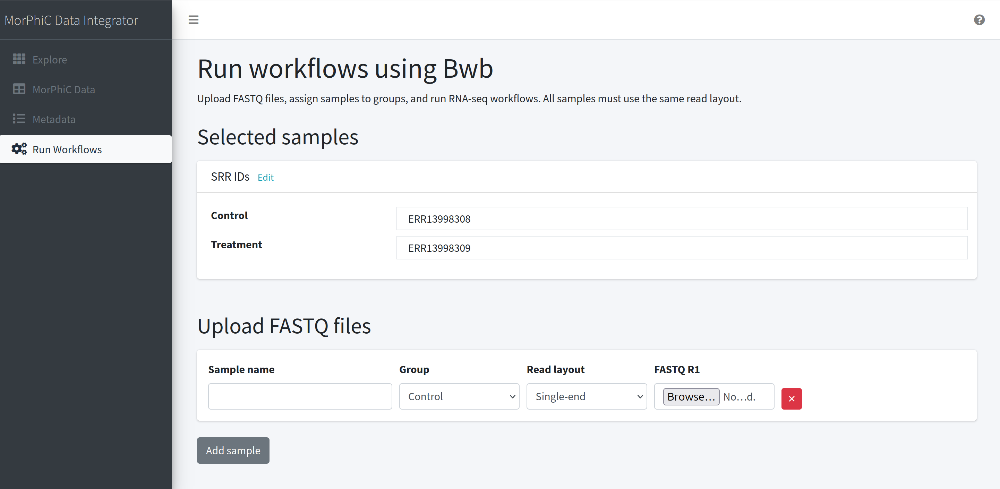

# Interactive Data Integration Dashboard

## About

Interactive Data Integrator facilates uniform data processing and integration with datasets generated by the NIH funded MorPhiC (Molecular Phenotypes of Null Alleles in Cells) program.

## Table of Contents

- [Project Setup](#project-setup)
    - [External dependencies](#external-dependencies)
    - [Prerequisites](#prerequisites)
    - [Clone the project](#clone-the-project)
    - [Option A: Docker Setup](#option-a-docker-setup)
    - [Option B: Local Setup](#option-b-local-setup)
    - [Testing](#testing)
- [Steps and Analysis](#steps-and-analysis)
- [Troubleshooting](#troubleshoting)
- [Technologies Used](#technologies-used)

## Project Setup

This project provides option to setup using either **Docker** (recommended for quick setup) or as a **Local Installation** (recommended for active development)

### External dependencies

This repo depends on code from the following repositories. These are installed / run automatically by the applications source.

- BWB SCHEDULER: Source code at https://github.com/Patrick-McKeever/bwb\_scheduler, docker image at `patrickmckeever/bwb-scheduler:latest`
- MORPHIC Bulk RNA seq workflow: Source code at https://github.com/morphic-bio/Bulk-RNA-seq/

### Prerequisites

Before you begin, ensure you have the following installed on your local machine:

- **Python 3.12** (Required version)
    
    Check version
    ```
    python3 --version
    ```
    example output
    ```
    Python 3.12.3
    ```
- **pip** (Python package manager)
- **Docker**
- **Git**
- Terminal or Command Prompt access


### Clone the project

1. On GitHub website, navigate to the main page of the repository.
2. Above the list of files, click "<> Code".
3. Copy the URL for the repository.
    - To clone the repository using HTTPS, under "HTTPS", copy the link
4. Open Terminal
5. Change the current working directory to the location where you want the cloned directory.
6. Type `git clone`, and then paste the URL you copied earlier.
    ```
    git clone https://github.com/BioDepot/MorPhiC-Data-Integrator.git
    ```
7. Press Enter to create your local clone.
8. Navigate into the project working directory
    ```
    cd MorPhiC-Data-Integrator
    ```

### Option A: Docker Setup
If you are on an arm64 system, it will be necessary to rebuild certain images for arm64 locally before running. This is a temporary fix, and we will push arm64 images to docker hub shortly. If you are on x86_64, you can ignore the before steps.
```
docker build -t patrickmckeever/rnotebook:0.4 patrickmckeever/rpcaDocker

git clone https://github.com/Patrick-McKeever/bwb_scheduler
cd bwb_scheduler
docker build -t patrickmckeever/bwb_scheduler:latest
```
After [cloning the project](#clone-the-project) and navigating into the working directory.

Build the Docker image and run the container

```
docker build -t data_integrator .
SRC=$(pwd) && SCHED_DIR=/data && sudo docker run --rm -it -p 5000:5000 -v $SCHED_DIR:$SCHED_DIR -v $SRC:$SRC -v /var/run/docker.sock:/var/run/docker.sock -e BWB_SCHED_DIR=$SCHED_DIR  docker.io/library/data_integrator sh -c "cd $SRC && flask run"
```

Open your web browser and navigate to http://127.0.0.1:5000/


### Option B: Local Setup

Start by [cloning the project](#clone-the-project) and navigating into the working directory.

#### Installing dependencies

In the project working directory:
- Create a virtual environment with python

    - macOS/Linux/Windows
    ```
    python3.12 -m venv .venv
    ```
- Activate the virtual enviroment

    - macOS/Linux
    ```
    source .venv/bin/activate
    ```

    - Windows (Command Prompt)
    ```
    .venv\Scripts\activate.bat
    ```
    After acitvation your prompt should look similar to
    ```
    (.venv)
    ```

    Verify the virtual enviroment is using python 
    ```
    python3.12 --version
    ```
    Expected Output
    ```
    Python 3.12.x
    ```
- Install Dependencies: 
  - With PIP: 
  ```shell 
  pip install -r requirements.txt
  ```

#### Start the project

1. Activate your python virtual environment

2. Run the web app with
    ```shell
    python run.py
    ```
    or 
    ```shell
    $ flask run
    ```
    After a few moments, the command line should output a message letting you know the development server is ready.

3. Open your web browser and navigate to http://127.0.0.1:5000/

You’ll be able to visit the site locally as long as your development server is running. To stop running, go back to your terminal window, then hit `ctrl-c`. To deactivate the Python virtual enviroment type and enter the command `deactivate` after stop running.

## Testing

Run all Tests:
```
PYTHONPATH=. pytest
```

Run specific tests like unit tests:
```
PYTHONPATH=. pytest -m unit
```

## Steps and Analysis

Run the application using the previous setup.

The steps can be summarized by:
1. Exploring datasets and selecting relevant studies.
2. View metadata available, assign samples to groups.
3. Review selected samples and add additional fastq files (optional)
4. Run the run the MORPHIC Bulk RNA sequencing pipeline.
5. View resuls and download counts.

Explore available datasets from the MorPhiC Consortsium Public Data Release by navigating to data page.


Select a relevant studies, each selection will use the accession ID to show metadata in the next page. Additional external studies (non-MorPhiC bulk RNA-seq) published in GEO can be added by optionally entering GSE accession numbers.


Clicking "Next", will show available metadata for each study.

Metadata, gathered from the NCBI Sequence Read Archive (SRA) and the European Bioinformatics Institute’s European Nucleotide Archive (ENA), is available for each previously selected study.


Create sample groupings by selecting "Define groups". In the menu, set group names and click "Save groups" when done. 


Edit group names by selecting "Edit groups".


View samples for each study. Samples from the MorPhiC program will be listed under the "MorPhiC Samples" tab. Non-MorPhiC samples will be listed under "External Samples". Select and assign samples to groups.


After selecting samples, navigate to "Next Run Workflow". Current selection of samples and their respective groups will be displayed. To make any modifications select "Edit". The option to upload fastq files is available for uniformly processing private data. Select "Run" when ready. Running a workflow will run the MORPHIC Bulk RNA sequencing pipeline via the Biodepot scheduler.



The status of the workflow will show at the top of screen. When complete, the page will refresh to show results. Option to download counts is available.

## Troubleshoting
- When uisng local setup of the project, some packages will require Python version 3.12. Please ensure that your setup uses Python 3.12. Alternatives versions such as 3.9 to 3.12 may work. Run previous setup instructions with specific Python version by replacing `python3.12` with `python3.10`.

    Check if specific version of Python is available
    - macOS/Linux
    ```
    python3.12 --version
    ```
    Replace 3.xx with the version, like 3.10.

    If available the exact version will be returned (e.g., `Python 3.12.3`). If not available your will see a command not found error.
    
    - Windows
    ```
    py -0
    ```
    This will list all the Python versions in your system (e.g., `-3.11-64`, `3.12-64`).

## Technologies Used

- **Flask**: Web framework
- **Python**: Programming Language
- **Biodepot Scheduler**
- **Git**: Version Control

