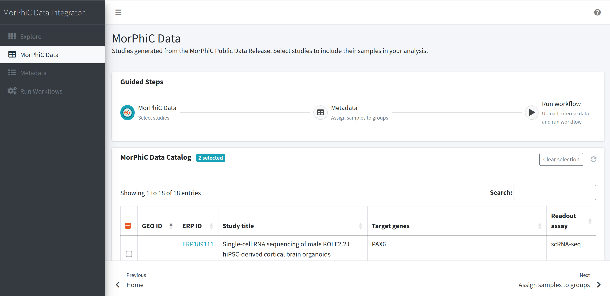
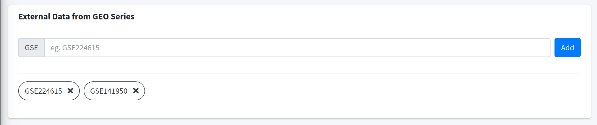
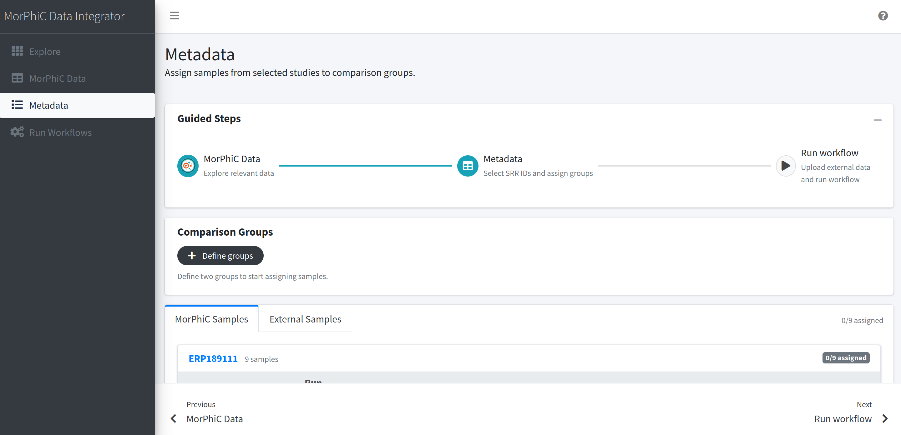
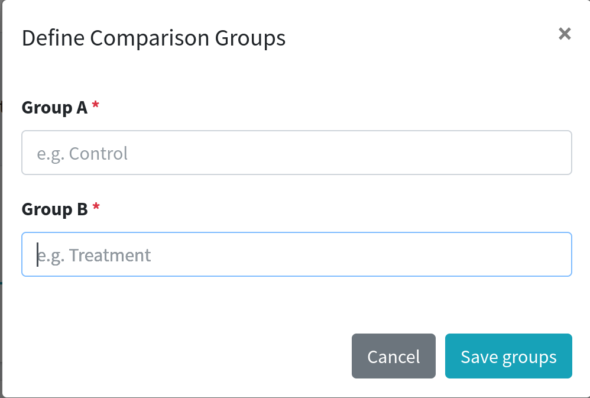
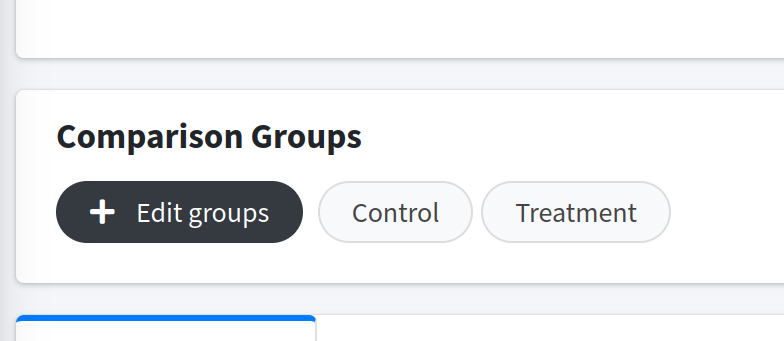
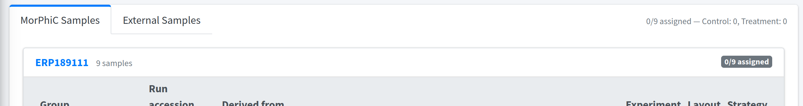
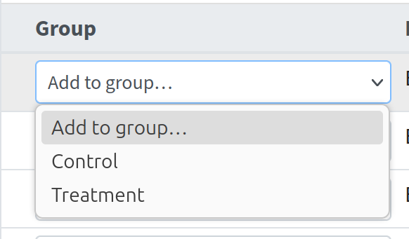
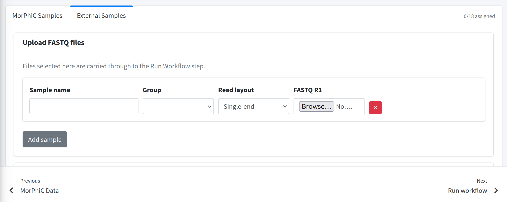

# Interactive Data Integration Dashboard

## About

Interactive Data Integrator facilates uniform data processing and integration with datasets generated by the NIH funded MorPhiC (Molecular Phenotypes of Null Alleles in Cells) program.

## Table of Contents

- [Installation](#installation)
    - [Option 1: Docker Setup](#option-1-docker)
    - [Option 2: Local Setup](#option-2-local-development)
- [Usage: Steps and Analysis](#usage-steps-and-analysis)
- [Troubleshooting](#troubleshoting)
- [Technologies Used](#technologies-used)

## Installation

This project provides option to setup using either **Docker** (recommended for quick setup) or as a **Local Installation** (recommended for active development)

**External dependencies**

This repo depends on code from the following repositories. These are installed / run automatically by the applications source.

- BWB SCHEDULER: Source code at https://github.com/Patrick-McKeever/bwb\_scheduler, docker image at `patrickmckeever/bwb-scheduler:latest`
- MORPHIC Bulk RNA seq workflow: Source code at https://github.com/morphic-bio/Bulk-RNA-seq/

### Option 1: Docker

**Requirements**: **Docker**

#### Linux/AMD64
The following section deals with setup for Linux/Amd64. It assumes that docker has been installated. The integrator may be run like so.
```
git clone https://github.com/BioDepot/MorPhiC-Data-Integrator.git && cd MorPhiC-Data-Integrator
docker build -t data_integrator .
SRC=$(pwd) && SCHED_DIR=/data && sudo docker run --rm -it -p 5000:5000 -v $SCHED_DIR:$SCHED_DIR -v $SRC:$SRC -v /var/run/docker.sock:/var/run/docker.sock -e BWB_SCHED_DIR=$SCHED_DIR  docker.io/library/data_integrator sh -c "cd $SRC && flask run"
```

#### Mac
For Macs, it will be required to use multipass or a similar system in order to run the linux/arm64 docker images. Multipass may be installated from [this link](https://canonical.com/multipass/install).
```
multipass launch 24.04 --name docker-vm --disk 50G
multipass shell docker-vm
sudo snap install docker
sudo addgroup --system docker
sudo adduser $USER docker
newgrp docker
git clone https://github.com/BioDepot/MorPhiC-Data-Integrator.git && cd MorPhiC-Data-Integrator
docker build -t data_integrator .
SRC=$(pwd) && SCHED_DIR=/data && sudo docker run --rm -it -p 5000:5000 -v $SCHED_DIR:$SCHED_DIR -v $SRC:$SRC -v /var/run/docker.sock:/var/run/docker.sock -e BWB_SCHED_DIR=$SCHED_DIR  docker.io/library/data_integrator sh -c "cd $SRC && flask run"
```

### Option 2: Local Development

**Requirements**
- Linux/Amd64
- **Python 3.12** (Required version)
- **pip** (Python package manager)
- **Docker**

#### Steps
```
# Clone and navigate to project directory
git clone https://github.com/BioDepot/MorPhiC-Data-Integrator.git
cd MorPhiC-Data-Integrator

# Create a virtual environment
python3.12 -m venv .venv

# Activate the virtual enviroment
source .venv/bin/activate

# Upgrade pip and install dependencies
pip install --upgrade pip
pip install -r requirements.txt

# Run the application
flask run
```

Open your web browser and navigate to http://127.0.0.1:5000/

You’ll be able to visit the site locally as long as your development server is running. To stop running, go back to your terminal window, then `ctrl-c`. To deactivate the Python virtual enviroment type and enter the command `deactivate` after stop running.

#### Testing

Run all Tests:
```
PYTHONPATH=. pytest
```

Run specific tests like unit tests:
```
PYTHONPATH=. pytest -m unit
```

## Usage: Steps and Analysis

Run the application using the previous setup.

The steps can be summarized by:
1. Exploring datasets and selecting relevant studies.
2. View metadata available, assign samples to groups.
3. Add additional fastq files (optional)
4. Run the MORPHIC Bulk RNA sequencing pipeline.
5. View results and download counts.

Explore available datasets from the MorPhiC Consortsium Public Data Release by navigating to data page.



Select a relevant studies, each selection will use the accession ID to show metadata in the next page. Additional external studies (non-MorPhiC bulk RNA-seq) published in GEO can be added by optionally entering GSE accession numbers. This option is located under the data table.



Clicking "Next", will show available metadata for each study.

Metadata, gathered from the NCBI Sequence Read Archive (SRA) and the European Bioinformatics Institute’s European Nucleotide Archive (ENA), is available for each previously selected study.


Create sample groupings by selecting "Define groups". In the menu, set group names and click "Save groups" when done. 



Edit group names by selecting "Edit groups".



View samples for each study. Samples from the MorPhiC program will be listed under the "MorPhiC Samples" tab. Non-MorPhiC samples will be listed under "External Samples". Select and assign samples to groups.





Selecting the "External Samples" tab will open the option to upload fastq files for uniformly processing private data. This tab also includes samples for previously inputed external GEO ID's.



After selecting samples, navigate to "Next Run Workflow". Select "Run" when ready. Running a workflow will run the MORPHIC Bulk RNA sequencing pipeline via the Biodepot scheduler.

The status of the workflow will show at the top of screen. When complete, the page will refresh to show results. Option to download counts is available.

## Troubleshoting
- When uisng local setup of the project, some packages will require Python version 3.12. Please ensure that your setup uses Python 3.12. Alternatives versions such as 3.9 to 3.12 may work. Afer installing a different python version, run previous setup instructions by replacing `python3.12`.

    For example, create a virtual environment with `python3.10`.
    - macOS/Linux/Windows
        ```
        python3.10 -m venv .venv
        ```

## Technologies Used

- **Flask**: Web framework
- **Python**: Programming Language
- **Biodepot Scheduler**
- **Git**: Version Control

